# Star Typing — слепая печать + английский + скорочтение «Пульт пилота» 🚀


*«Живой космос» (3.5): [полное видео MP4](docs/living_space/living_space.mp4) · подробнее — [ниже](#живой-космос-версия-35).*

## Обновления (GitHub Releases)

С версии **3.7.0** программа сама проверяет [Releases](https://github.com/Teslyar75/My_Stamina/releases):

- при входе — диалог, если есть новая версия;
- **НАСТРОЙКИ → ЕЩЁ → Обновления**: «Проверить», changelog, **«Обновить сейчас»** (скачает ZIP тега, обновит файлы, сохранит пилотов / `.venv` / `models` / `cache`, перезапустит).

Как выпустить релиз разработчику: обновите `CHANGELOG.md` и `stamina/__init__.py` → `__version__`, затем:

```bash
git tag v3.7.0
git push origin v3.7.0
```

GitHub Actions создаст Release с notes из changelog.

---

## 🚀 Быстрый старт для новичка

**Ваша система:** [🪟 Windows](#windows--один-двойной-щелчок) · [🐧 Linux (Ubuntu и др.)](#linux-ubuntu--одна-команда)

### Windows — один двойной щелчок
1. Скачайте программу: зелёная кнопка **Code → Download ZIP**
   ([прямая ссылка](https://github.com/Teslyar75/My_Stamina/archive/refs/heads/master.zip)) и распакуйте,
   например, в `C:\StarTyping`. (Или `git clone https://github.com/Teslyar75/My_Stamina.git`.)
2. Дважды щёлкните **`install.bat`**. Он сделает всё сам:
   - нет Python — поставит Python 3.12 через `winget` (если winget нет, откроет python.org: при установке
     поставьте галочку **«Add python.exe to PATH»** и запустите `install.bat` ещё раз);
   - создаст папку `.venv`, поставит Pillow; спросит один раз (20 с, по умолчанию «нет») про проверку
     произношения (vosk + модель ~40 МБ);
   - создаст ярлык **«Star Typing»** на рабочем столе (это `create_shortcut.ps1`; вручную:
     `powershell -ExecutionPolicy Bypass -File create_shortcut.ps1`) и запустит программу.
3. Дальше — ярлык на рабочем столе или `Stamina.bat`. Если запустить `Stamina.bat` раньше `install.bat`,
   он сам предложит установку.

### Linux (Ubuntu) — одна команда
1. Скачайте и распакуйте ZIP (как выше) или `git clone https://github.com/Teslyar75/My_Stamina.git`.
2. В папке программы выполните:
   ```bash
   bash install.sh
   ```
   Скрипт спросит пароль sudo и поставит всё: `python3 python3-tk python3-venv python3-pip libportaudio2
   espeak-ng alsa-utils` (apt; есть варианты для dnf, pacman, zypper), папку `.venv` с Pillow, vosk и
   sounddevice, модель речи, ярлык в меню (`~/.local/share/applications/star-typing.desktop`) и на рабочем
   столе — и запустит программу. Потом запуск: ярлык или `./run.sh`. Без проверки произношения:
   `bash install.sh --no-voice`.

   Совсем без ZIP, одной строкой (скачает в `~/StarTyping`):
   ```bash
   curl -fsSL https://raw.githubusercontent.com/Teslyar75/My_Stamina/master/install.sh | bash
   ```

### Что вы увидите
| 1. Добро пожаловать на борт | 2. Создание пилота | 3. Мостик: первая миссия |
|---|---|---|
| 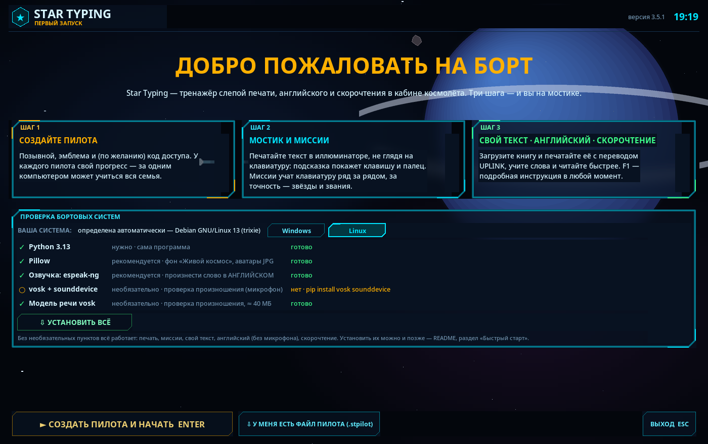 | 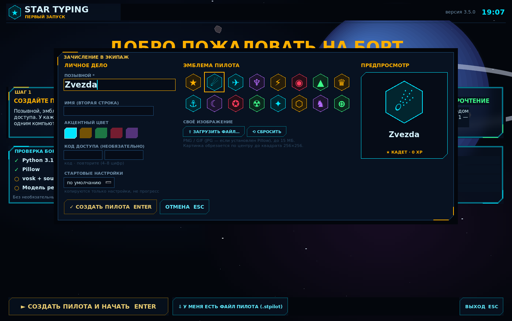 |  |

1. **«ДОБРО ПОЖАЛОВАТЬ НА БОРТ»** — три шага о разделах и **проверка бортовых систем**: система
   определяется сама (Windows / Linux, можно поправить), рядом — что установлено: Pillow, озвучка
   (SAPI в Windows, espeak-ng в Linux), vosk + sounddevice, модель речи. Чего-то нет — одна кнопка
   **«УСТАНОВИТЬ ВСЁ»** (pip; системные пакеты Linux — через окно пароля, или покажет команду `sudo apt …`).
2. **«СОЗДАТЬ ПИЛОТА И НАЧАТЬ»** (Enter) — позывной, эмблема, цвет, код доступа по желанию.
3. **Мостик** с первой миссией (клавиши F и J) — просто начните печатать. **F1** — инструкция.

### Если что-то не так
| Проблема | Решение |
|---|---|
| `python` не найден / «Python не установлен» (Windows) | запустите `install.bat`; если winget нет — поставьте Python с python.org с галочкой **Add python.exe to PATH**, перезапустите `install.bat` |
| Открывается Microsoft Store вместо Python | Параметры → Приложения → Псевдонимы выполнения приложений → выключите `python.exe`/`python3.exe`, затем `install.bat` |
| Нет фона «Живой космос», в настройках «Не установлен Pillow» | кнопка «УСТАНОВИТЬ ВСЁ» в приветствии или `install.bat` / `bash install.sh` |
| Linux: `No module named tkinter` | `sudo apt install python3-tk` (или просто `bash install.sh`) |
| Linux: `externally-managed-environment` при pip | ставьте через `bash install.sh` — он делает отдельную `.venv` |
| Не слышно звуков / озвучки (Linux) | `sudo apt install alsa-utils espeak-ng`; проверьте: `espeak-ng "hello"` |
| Микрофон не работает | Windows: Параметры → Конфиденциальность → Микрофон → разрешить приложениям; Linux: `sudo apt install libportaudio2`, выберите микрофон в настройках звука. Без микрофона «говорение» переходит на самооценку |
| Данные | Windows: `%APPDATA%\Stamina`, Linux: `~/.local/share/StarTyping` |

*Бывший **Stamina**.*

Star Typing — настольная программа на Python (tkinter) в стиле **пульта
космического корабля**. Основные задачи:

1. **Слепая печать** — скорость, точность, ритм, миссии по рядам клавиатуры
   (английская QWERTY и русская ЙЦУКЕН), звания и бортжурнал.
2. **Изучение английского** — вы загружаете книгу или статью на английском и
   печатаете её, а панель **UPLINK** показывает перевод **текущего слова**
   (под прицелом, с красной подсветкой нужной буквы) и **всего предложения**.
   Печать и словарь идут одним потоком: пальцы учатся, мозг запоминает слова
   в контексте.
3. **Скорочтение** — гипердрайв (RSVP по слову с красной буквой-точкой фиксации и
   плавным разгоном), обычная читалка **«Книга»** с полки, проверка понимания и тренажёры
   обзора: Шульте, Горбов, пирамида, вспышка. Библиотека общая с печатью + свободные книги Gutenberg.

С версии 3.4 за одним компьютером может заниматься **целый экипаж**: у каждого пилота свой
профиль (позывной, эмблема, необязательный код доступа) и весь свой прогресс, а **ДОСКА ПОЧЁТА**
показывает, кто впереди.

## Что умеет программа (кратко)

| Отсек | Возможности |
| --- | --- |
| **Мостик** | Слепая печать через прицел, скорость/точность/ритм, зоны пальцев, UPLINK-перевод слова и предложения |
| **Миссии** | 10 EN + 10 RU по рядам клавиатуры, звёзды, «Ремонт систем», продолжение своего текста |
| **Свой текст** | Файл / буфер / PDF → подготовка (регистр, знаки, умлауты) → печать с сохранением места |
| **Бортжурнал** | Рекорды, график заходов, тепловая карта ошибок EN/DE/RU/UA, слабые клавиши |
| **Английский** | 20 000 слов + IT Interview, сканер, микрофон (Vosk), SM-2, склад, **ИЗ КНИГИ** (предложения из прочитанного) |
| **Скорочтение** | Гипердрайв (RSVP + перевод), читалка **Книга** / **2 ЯЗЫКА**, Gutenberg с поиском **по CEFR A1–C2** |
| **Отдых** | Тетрис, змейка, арканоид; рекорды на борту |
| **Радиорубка** | radio-browser.info, избранное, ICY-трек, мини-бар в шапке (нужен **mpv**) |
| **Эфир** | Общий канал экипажа: пилоты одного компьютера переписываются; непрочитанное подсвечивает раздел |
| **Орион** | Бортовой разум: приём ИИ-агента на борт, чат, голос пилота и озвучка, права на входе, документ манер |
| **Экипаж** | Несколько пилотов, код доступа, доска почёта, экспорт `.stpilot` |
| **Прочее** | Живой космос (Pillow), UI ru/uk/en/de, навигация с клавиатуры (Tab), F1-инструкция |

Полный чеклист: [docs/CAPABILITIES.md](docs/CAPABILITIES.md) · инструкция пилота: [ИНСТРУКЦИЯ.md](ИНСТРУКЦИЯ.md) (F1) ·
вайбкодинг: [VIBE_CODING.md](VIBE_CODING.md).

## Новое (октябрь 2026)

- **ЭФИР (Ctrl+6) — канал связи экипажа.** Пилоты одного компьютера оставляют друг другу
  сообщения в общей ленте: непрочитанное подсвечивает раздел, ответ — строкой ввода внизу (Enter).
  Это прототип и фундамент будущего **онлайн-эфира флота**: слой данных повторяет будущее
  серверное API, поэтому при онлайне экран не переписывается. Подробно: [docs/COMM_ETHER.md](docs/COMM_ETHER.md).
- **Скин «Старая Англия»** — туман, слайдшоу, радио (F7), 357 строк своей лексики; Звездолёт по умолчанию.
- **Звуки скинов** и **Esc-перезапуск змейки** (PR #19).
- **ОРИОН (Ctrl+7, Home) — приём агента на борт.** Бортовой разум живёт как пассажир корабля: чат
  с живой линией и доской, микрофон (Vosk) и озвучка ответа голосом корабля, задания в документ борта.
  **Права выдаются на входе** (Экипаж / Наблюдатель / Командир), а права Командира — только по **коду
  владельца** корабля; поведение агента пилот пишет сам — **документом манер** на борту. Подробно:
  [docs/ORION_BOARD.md](docs/ORION_BOARD.md).
- **Гид ОРИОН** — на десктопе **в планах** (порт с веба); в [веб-версии](https://github.com/Teslyar75/Wed_Star_Typing_Version) уже есть. Видение: [docs/ORION_VISION.md](docs/ORION_VISION.md).

| Мостик в скине | Слайдшоу |
| --- | --- |
| 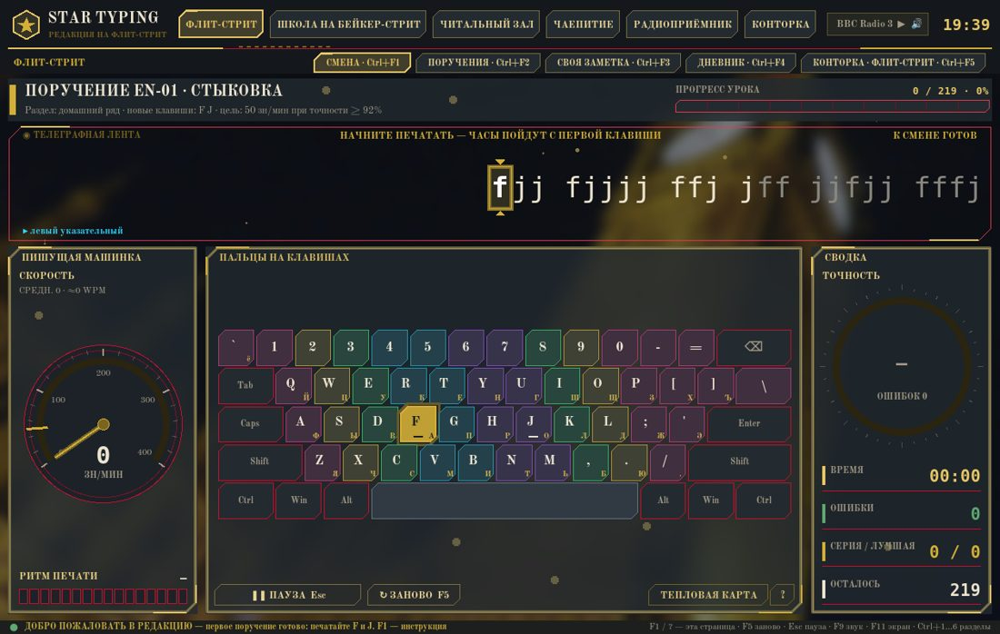 |  |

Подробно: [docs/FEATURES_2026-10.md](docs/FEATURES_2026-10.md) · Орион: [docs/ORION_VISION.md](docs/ORION_VISION.md) · скриншоты: [docs/showcase_new/](docs/showcase_new/)

**Контекст для разработки и план работ:** [docs/PROJECT_CONTEXT.md](docs/PROJECT_CONTEXT.md)

**Планы портала печати (Ctrl+M):** мягкий переход с Monkeytype — прогресс оттуда сам импортируется (только чтение) в общую таблицу, наши результаты в приоритете, история не теряется; постепенно — наборы настроек в духе Monkeytype (режимы, пунктуация/цифры, стили каретки, звуки, темы). Подробнее: [docs/DEVELOPMENT_PLAN.md](docs/DEVELOPMENT_PLAN.md#12-портал-печати-дзен-ctrlm--планы)

**Разбор зависания (100 % CPU, окно не отвечает):** [docs/HANG_100_CPU_2026-10-20.md](docs/HANG_100_CPU_2026-10-20.md) — причина, замеры, правила, чтобы не повторилось.

## Бортовой ИИ «Орион»

| Чат с Орионом | Гид по умолчанию |
| --- | --- |
|  |  |

**Орион** — бортовой разум корабля:

- **Чат** — общение с агентом через OpenCode CLI, голосовой ввод (Vosk), озвучка ответа (TTS)
- **Гид по умолчанию** — при входе в любой отсек приветствует и рассказывает что происходит
- **Режим мастера** — «нужен мастер» — следит за мышью и даёт подсказки
- **Радио и книги** — управление радиорубкой и чтение книг вслух
- **Эволюция** — 6 уровней развития от общения
- **Права** — Экипаж / Наблюдатель / Командир (по коду владельца + GitHub)
- **Кнопка «ДЕРЖАТЬ»** — остановка зависшего вызова агента

Подробно: [docs/ORION_VISION.md](docs/ORION_VISION.md) · [docs/SESSION_REPORT_2026-10-19.md](docs/SESSION_REPORT_2026-10-19.md)

---

## Читалка · Радиорубка · Отдых

| Читалка «Книга» | Радиорубка | Комната отдыха |
| --- | --- | --- |
| 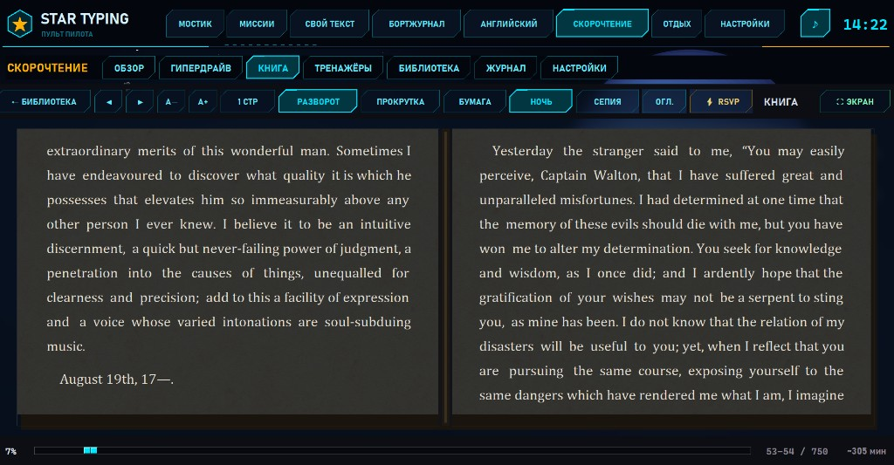 |  |  |

**Читалка** — рядом с гипердрайвом: режимы **1 СТР / РАЗВОРОТ / 2 ЯЗЫКА / ПРОКРУТКА**, темы Бумага · Ночь · Сепия,
оглавление, прогресс и оценка времени; жёсткие переносы Gutenberg склеиваются в сплошной текст.
Режим **2 ЯЗЫКА** — слева оригинал, справа перевод: у обычных книг — по предложениям (UPLINK);
у книг с готовым переводом (`kind=bilingual`, файл `translation.txt`) — без сети, по абзацам.
Такие книги на полке со значком **2ЯЗ**: без правки текста, без печати, без UPLINK-режима;
в гипердрайве — выбор **языка потока**, без перевода под словом. Свободные книги Gutenberg:
поиск по названию/автору и **по категориям CEFR (A1…C2)**. Предложения из прочитанного —
в **АНГЛИЙСКИЙ → ИЗ КНИГИ**. Подробнее — [ниже](#книга-обычная-читалка-с-полки).

**Радиорубка** — поиск по стране / языку / жанру, **★ МОИ ВОЛНЫ**, **ПРИЁМНИК** с «В ЭФИРЕ» и историей
треков; эфир играет в фоне (мини-бар в шапке), приглушается при TTS и микрофоне.
Windows: `winget install -e --id shinchiro.mpv`. Подробнее — [ниже](#радиорубка-онлайн-радио).

**Отдых** — **ТЕТРИС**, **ЗМЕЙКА**, **АРКАНОИД** в стиле пульта; Esc/P — пауза, R — заново.
Подробнее — [ниже](#комната-отдыха-отдых).

Для печати внешних зависимостей нет: Python 3.10+ (стандартная библиотека). Для «Живого космоса»
и аватаров — **Pillow**; для произношения — `vosk` + `sounddevice` (необязательно).

> **Название.** С версии 3.1 — **Star Typing** (раньше Stamina). Внутри: папка `D:\My_New_Stamina`,
> `main.py`, пакет `stamina/`, данные `%APPDATA%\Stamina`, репозиторий `Teslyar75/My_Stamina`.

## Пульт: основные экраны

**Мостик + UPLINK.** Текст через прицел, красная буква в слове, перевод слова и предложения,
двигатель (зн/мин), клавиатура с зонами пальцев.


| Миссии | Свой текст · Бортжурнал |
| --- | --- |
| 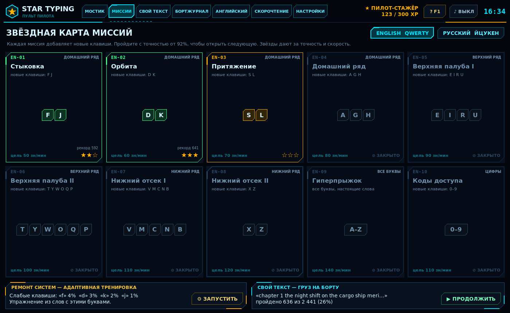 | 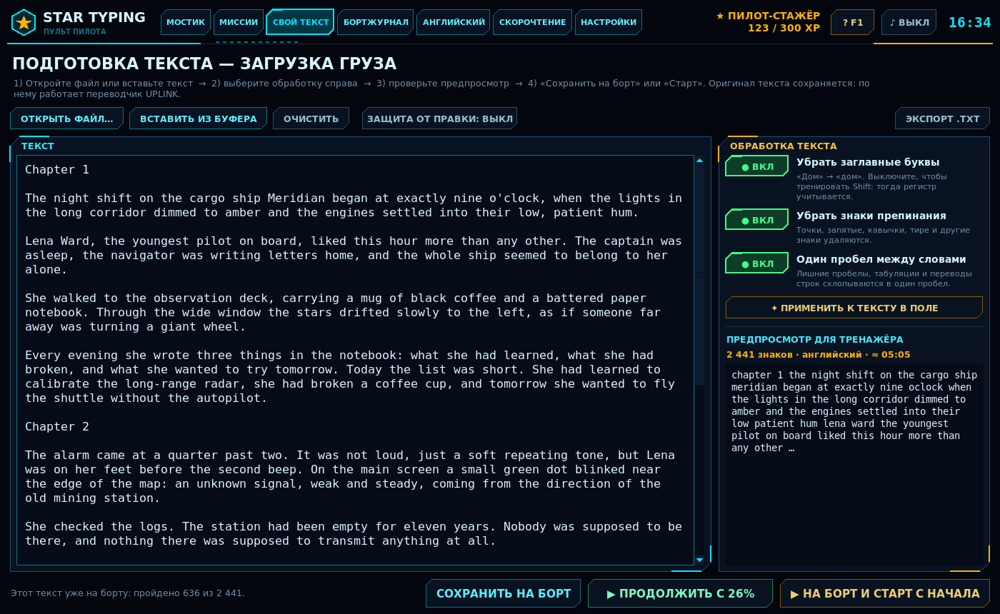 |
| Звёздная карта, звёзды, ремонт слабых клавиш. | Подготовка груза; в бортжурнале — график и тепловая карта. |
| **Английский** | **Скорочтение** |
| 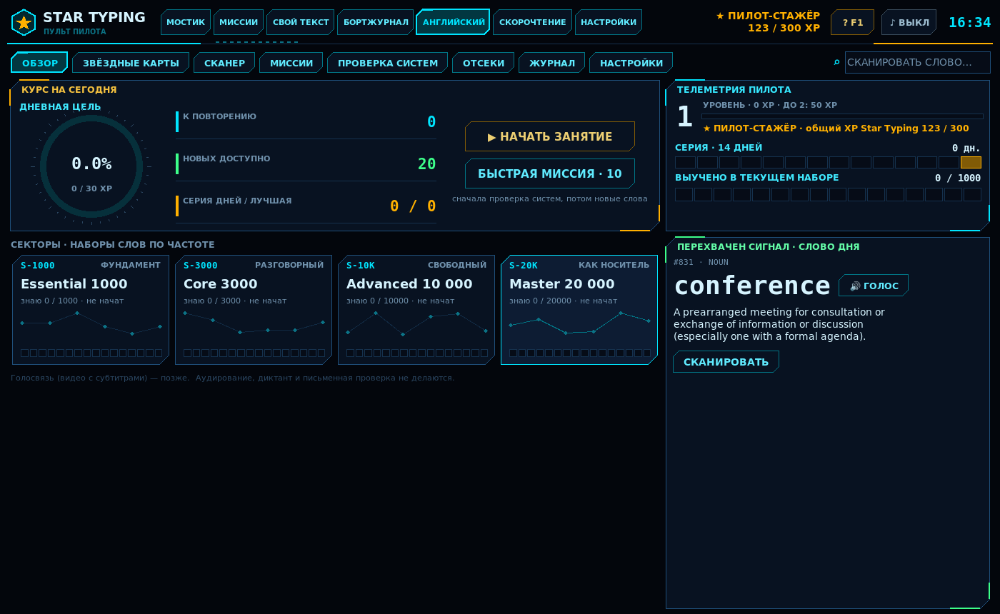 | 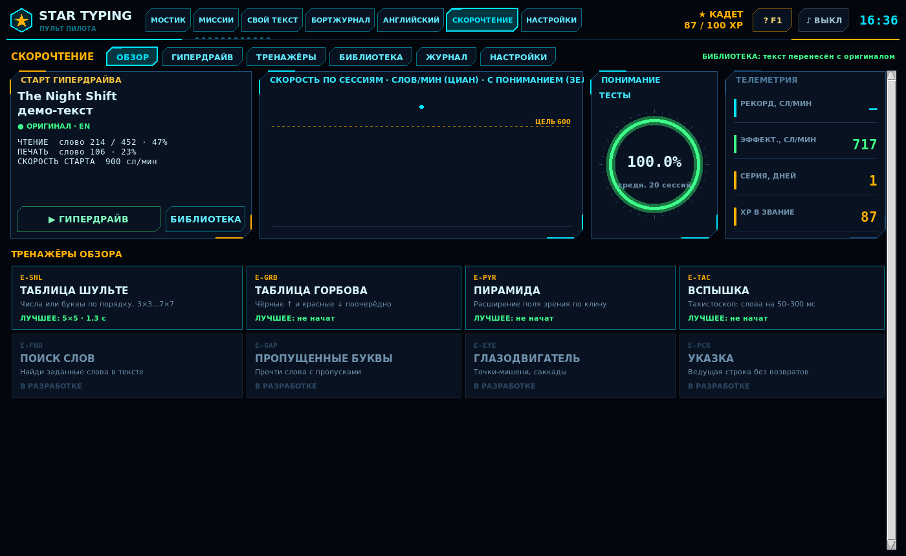 |
| Сканер, миссии с микрофоном, карточки. | Обзор: график скорости, тренажёры, место в тексте. |
| **Экипаж** | **Доска почёта** |
| 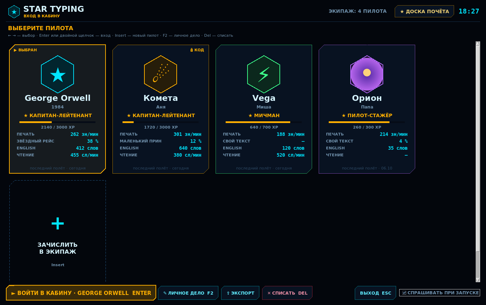 | 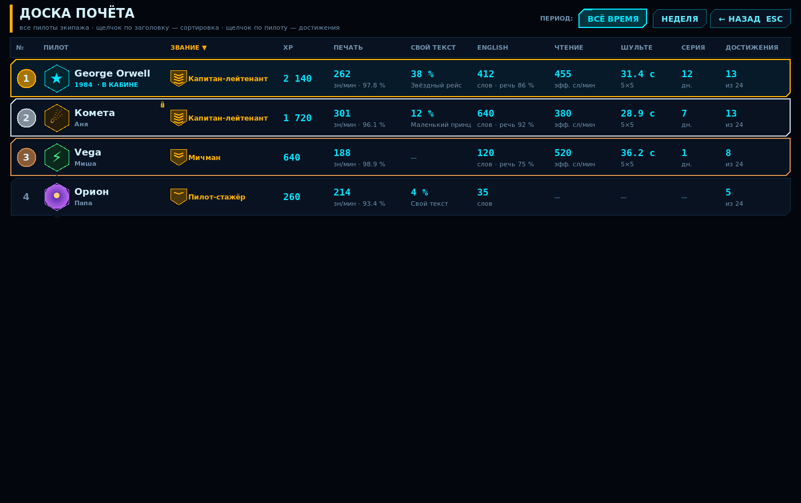 |
| Карточки пилотов и код доступа. | Рейтинг по XP, печати, английскому, чтению. |

## Разделы

| Раздел | Клавиши | Что там |
| --- | --- | --- |
| **Мостик** | Ctrl+1 | Тренировка: иллюминатор со строкой набора, спидометр, кольцо точности, ритм, телеметрия, клавиатура, переводчик UPLINK |
| **Миссии** | Ctrl+2 | 10 английских и 10 русских миссий, звёзды, «Ремонт систем», продолжение своего текста |
| **Свой текст** | Ctrl+3 | Подготовка текста: файл или буфер, переключатели «без заглавных / без знаков / один пробел», предпросмотр, сохранить, старт, продолжить |
| **Бортжурнал** | Ctrl+4 | Время в полёте, рекорды, график 30 последних заходов, тепловая карта ошибок, слабые клавиши |
| **Английский** | Ctrl+5 | 20 000 слов, сканер, микрофон, **ИЗ КНИГИ** (предложения из читалки), SM-2, склад, отсеки |
| **Скорочтение** | Ctrl+6 | Гипердрайв (+ перевод), «Книга» / 2 ЯЗЫКА, Gutenberg **CEFR A1–C2**, тренажёры, журнал |
| **Отдых** | Ctrl+…* | Комната отдыха: тетрис, змейка, арканоид; рекорды на борту |
| **Радиорубка** | Ctrl+…* | Онлайн-радио: эфир, приёмник, мои волны; мини-бар в шапке (нужен mpv) |
| **Эфир** | Ctrl+…* | Общий канал экипажа: лента сообщений, непрочитанное подсвечивает раздел, ответ — Enter. Подробно: [docs/COMM_ETHER.md](docs/COMM_ETHER.md) |
| **Орион** | Ctrl+…* | Бортовой разум: заселение ИИ-агента на борт, чат и голос, права на входе и код владельца, документ манер. Подробно: [docs/ORION_BOARD.md](docs/ORION_BOARD.md) |
| **Настройки** | последний Ctrl | Звук и громкость, переводчик, звёзды, клавиатура, зоны пальцев, размер шрифта |

\* Номера Ctrl сдвигаются, если какая-то вкладка не подключена; **Настройки** всегда последние.

### Мостик
- **Иллюминатор** — текст «проезжает» через неподвижный прицел в центре (идея исходного
  Stamina). Набранное уходит влево и тускнеет, текущая буква в янтарной рамке.
  Ошибка — красная вспышка и подсказка «нажато «ы» — нужно «s»»; если перепутана
  раскладка, программа подскажет переключить её.
- **Звёзды** летят быстрее, когда вы печатаете быстрее (можно выключить).
- **Двигатель** — спидометр: живая скорость в знаках в минуту, средняя скорость и WPM
  (слов в минуту), янтарная отметка — цель миссии.
- **Телеметрия** — точность, время, ошибки, серия без ошибок, сколько осталось.
- **Ритм печати** — насколько ровно вы печатаете (100 % — как метроном).
- **Навигация пальцев** — клавиатура с подписями EN и RU, цветные зоны пальцев,
  следующая клавиша подсвечена, внизу иллюминатора подсказка, каким пальцем жать.
  Кнопка «Тепловая карта» показывает процент ошибок на каждой клавише.
- **UPLINK // ПЕРЕВОДЧИК** (только для своего текста) — см. отдельный раздел ниже.

### В чём фишка: печать + английский (UPLINK)

Панель UPLINK под иллюминатором — это и есть «учебный канал»:

| Элемент | Что показывает |
| --- | --- |
| Строка сверху | исходное английское предложение |
| **Окошко по центру (под прицелом)** | набираемое **слово**: слева оригинал, справа перевод; **красная** буква — та, которую нужно нажать сейчас; уже набранные буквы слова приглушены |
| Строка под окошком | перевод **всего предложения** крупным шрифтом |

Так вы не отрываетесь от набора: слово запоминается в момент печати, а предложение
даёт контекст. Для русского «груза» направление перевода обратное (RU → EN).
Переводчик работает в фоне, кэширует ответы и не тормозит печать.

### Время считается честно
Таймер стартует с первой нажатой клавиши. Если вы отошли и не печатали больше 4 секунд,
это время не засчитывается. **Esc** — пауза (Esc или Пробел — продолжить). Если окно
теряет фокус или вы уходите в другой раздел, полёт ставится на паузу сам.

### Миссии и звания
Каждая миссия добавляет новые клавиши: домашний ряд → верхний ряд → нижний ряд →
все буквы → цифры. Миссия засчитана при точности от 92 %:
★ — засчитано, ★★ — точность ≥ 95 % и скорость не ниже цели,
★★★ — точность ≥ 98 % и скорость на 25 % выше цели. Пройденная миссия открывает следующую.
За каждый заход начисляется опыт (XP), звания: Кадет → Пилот-стажёр → Мичман →
Лейтенант → Капитан-лейтенант → Капитан → Коммодор → Адмирал флота.

**Ремонт систем** — программа запоминает ошибки по каждой клавише и собирает упражнение
из слов, в которых много ваших «слабых» букв.

### Свой текст: главная функция Star Typing
Раздел **«Свой текст»** (Ctrl+3), панель «Подготовка текста — загрузка груза»:
1. **Полка книг** / **Свободные книги** — каталог [Project Gutenberg](https://www.gutenberg.org/)
   (общественное достояние): поиск по названию и автору, **▤ ПО КАТЕГОРИЯМ** (CEFR **A1–C2**),
   лента бесплатных книг **с обложкой или без**, скачивание на борт и набор.
   Либо **Открыть файл…** (`.txt`, UTF-8 или Windows-1251) / **Вставить из буфера**.
2. Справа, в панели **«Обработка текста»**, три независимых переключателя (по умолчанию включены все):
   - **Убрать заглавные буквы.** Если выключить, регистр учитывается, и вы тренируете Shift;
   - **Убрать знаки препинания.** Если выключить, знаки остаются, а типографские
     « » — … заменяются на обычные " - ..., чтобы их можно было набрать;
   - **Один пробел между словами.** Лишние пробелы, табуляции и переводы строк схлопываются.
3. **✦ Применить к тексту в поле** — выбранная обработка применяется прямо к тексту в редакторе
   (как «Применить все правки» в прежней версии).
4. **Предпросмотр для тренажёра**: что именно попадёт в строку набора, сколько знаков, язык и
   сколько времени займёт текст при вашей скорости.
5. **Сохранить на борт** (текст готов, старт с первой клавиши на Мостике), **На борт и старт с
   начала** или **Продолжить с …%**.
6. Ещё есть **Очистить**, **Защита от правки** (поле только для чтения) и **Экспорт .txt**
   (сохранить подготовленный текст в файл).

Оригинал текста сохраняется: по нему переводчик понимает, где кончается предложение.
Прогресс сохраняется автоматически, программу можно закрыть в любой момент и
потом нажать «Продолжить». Незаконченный текст из версии 2 (например, «1984»)
продолжается с того же места. Если заново открыть тот же файл, можно продолжить с того же
места, и переводчик начнёт работать по предложениям.

### Звук
- верная клавиша — щелчок печатной машинки;
- ошибка — глухой «бззт»;
- миссия выполнена — колокольчик каретки.

Звуки синтезирует сама программа (`stamina/sounds.py`), файлы лежат в `stamina/sounds/`.
Включить или выключить звук: F9 или кнопка «ЗВУК» вверху. Громкость меняется в настройках.

### Переводчик UPLINK (технически)
- Переводит **слово** и **предложение** отдельно (оба запроса кэшируются).
- Перевод идёт в фоне, печать никогда не тормозит.
- Сначала бесплатный Google Translate (без ключа), запасной вариант — MyMemory.
- Кэш: `cache/translations.json` рядом с программой — повторные фразы работают офлайн.
- Нет сети — на панели «НЕТ СВЯЗИ», повтор раз в 20 секунд.
- Выключается в настройках.

## Вкладка «АНГЛИЙСКИЙ» (версия 3.2)

Тренажёр английских слов прямо на борту — в том же стиле пульта, с теми же званиями и XP.
Работает без интернета, без регистрации и без платных сервисов.

- **20 000 слов** по частотности (Essential 1000, Core 3000, Advanced 10 000, Master 20 000) плюс набор **IT Interview (S-DEV)** — ~580 IT-терминов для собеседований по программированию.
- **Карточка слова (СКАНЕР):** определение, IPA, слоги и ударение, подсказки по трудным звукам,
  русский перевод (поле «МОЙ ПЕРЕВОД» заполнено заранее, свой вариант главнее), примеры
  предложений с переводом, озвучка обычной и медленной скоростью (голос Windows).
- **Проверка произношения:** читаете предложение в микрофон, распознавание Vosk без интернета
  показывает «СОВПАДЕНИЕ: 86%» и подсвечивает пропущенные слова. Индикатор «● СЛУШАЮ…» с живой
  шкалой громкости, затем «РАСПОЗНАЮ…». Без микрофона — самооценка.
- **Миссии** (говорение, чтение, вопросы), **флеш-карточки** с интервальным повторением SM-2,
  **склад карточек** (русский → английский вслух, несколько прогонов с оценкой, авто «отработано») —
  подробное описание со скриншотами: [docs/WAREHOUSE_CARDS.md](docs/WAREHOUSE_CARDS.md),
  **ИЗ КНИГИ** — карточки **предложений** из того, что вы уже пролистали в читалке (RU на лице,
  сказать EN вслух; 💡 ПОДСКАЗКА — удерживайте, чтобы мельком увидеть английский),
  **отсеки** (свои списки, экспорт CSV, импорт из .txt), **журнал** со знаками отличия.
- F1 на вкладке открывает главу «12. АНГЛИЙСКИЙ» в [инструкции](ИНСТРУКЦИЯ.md).

| Сканер: перевод и «СОВПАДЕНИЕ %» | Склад карточек |
| --- | --- |
| 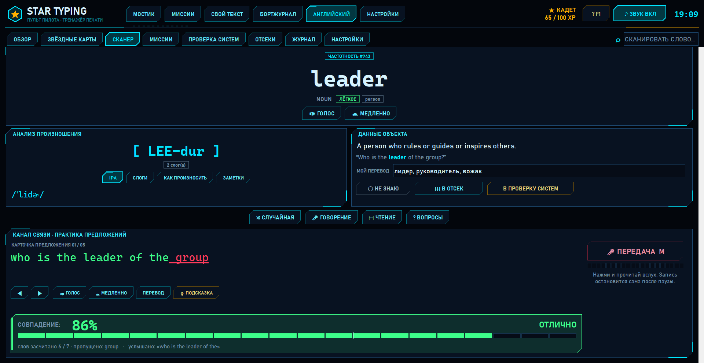 | 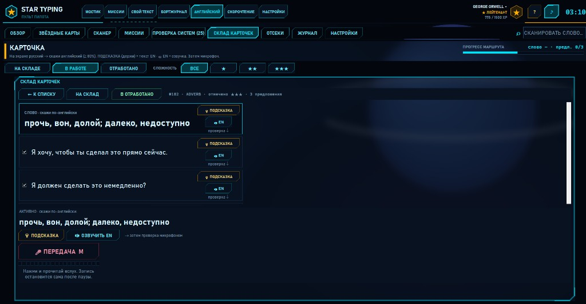 |
| IPA, озвучка, микрофон → % совпадения. | RU → EN вслух, несколько прогонов, «отработано». |

Подвкладки: **Обзор**, **Звёздные карты**, **ИЗ КНИГИ**, **Миссии**, **Проверка систем** (SM-2),
**Склад**, **Отсеки**, **Журнал**, **Настройки**. Подробнее про склад —
[docs/WAREHOUSE_CARDS.md](docs/WAREHOUSE_CARDS.md).

### IT Interview (S-DEV)

~580 IT-терминов для coding-собеседований: **Звёздные карты → S-DEV** (или набор в настройках).
Дальше — сканер, микрофон, склад. Источник — [CodersLingo](https://coderslingo.com/glossary/) (CC BY 4.0).
Описание: [docs/IT_INTERVIEW.md](docs/IT_INTERVIEW.md).

### Наборы слов: объём и примеры

Посчитано по `stamina/english/data/vocab.json`. Наборы вложены: Core 3000 включает Essential 1000 и т. д.

| Набор | Слов всего | Новых в наборе | Примеров (новые слова) | из них с переводом | Примеров всего (накопительно) | ≈ уровень CEFR |
| --- | ---: | ---: | ---: | ---: | ---: | --- |
| Essential 1000 | 1 000 | 1 000 | 4 983 | 4 983 | 4 983 | A1–A2 |
| Core 3000 | 3 000 | 2 000 | 9 610 | 9 610 | 14 593 | B1 |
| Advanced 10 000 | 10 000 | 7 000 | 24 138 | 24 138 | 38 731 | B2–C1 |
| Master 20 000 | 20 000 | 10 000 | 15 236 | 15 233 | 53 967 | C2 / почти как носитель (пассивно) |
| **Итого** | **20 000** | **20 000** | **53 967** | **53 964** | **53 967** | |

Дополнительно: набор **IT Interview (S-DEV)** — отдельный файл `stamina/english/data/vocab_dev.json` (~580 терминов). Не входит в частотные top-* по рангу. Сборка: `scripts/build_dev_vocab.py`.

Хотя бы один пример есть у 19 935 слов из 20 000. Соответствие CEFR примерное: это часто приводимые оценки по объёму словаря, а уровень зависит не только от количества слов (ещё грамматика, аудирование, речь, письмо).

Словарь (`stamina/english/data/vocab.json`) собран нашими скриптами только из открытых
источников — список и лицензии ниже, подробности в [docs/ENGLISH_DATA.md](docs/ENGLISH_DATA.md), скрипты сборки — в [tools/vocab_builder/](tools/vocab_builder/).
Устройство вкладки: [docs/ENGLISH_TAB.md](docs/ENGLISH_TAB.md), стиль: [docs/ENGLISH_DESIGN.md](docs/ENGLISH_DESIGN.md).

## Вкладка «СКОРОЧТЕНИЕ» (версия 3.3)

Тренажёр быстрого чтения в том же стиле пульта. Подразделы: **ОБЗОР**, **ГИПЕРДРАЙВ**,
**ТРЕНАЖЁРЫ**, **БИБЛИОТЕКА**, **ЖУРНАЛ**, **НАСТРОЙКИ**. XP за чтение и тренажёры идёт в общее
звание Star Typing. F1 на вкладке открывает главу «13. СКОРОЧТЕНИЕ» в [инструкции](ИНСТРУКЦИЯ.md).

### Гипердрайв и обзор
На **ОБЗОРЕ** — текущий текст, график скорости (цель пунктиром), понимание, рекорды тренажёров и XP
(снимок — [выше](#пульт-основные-экраны)).

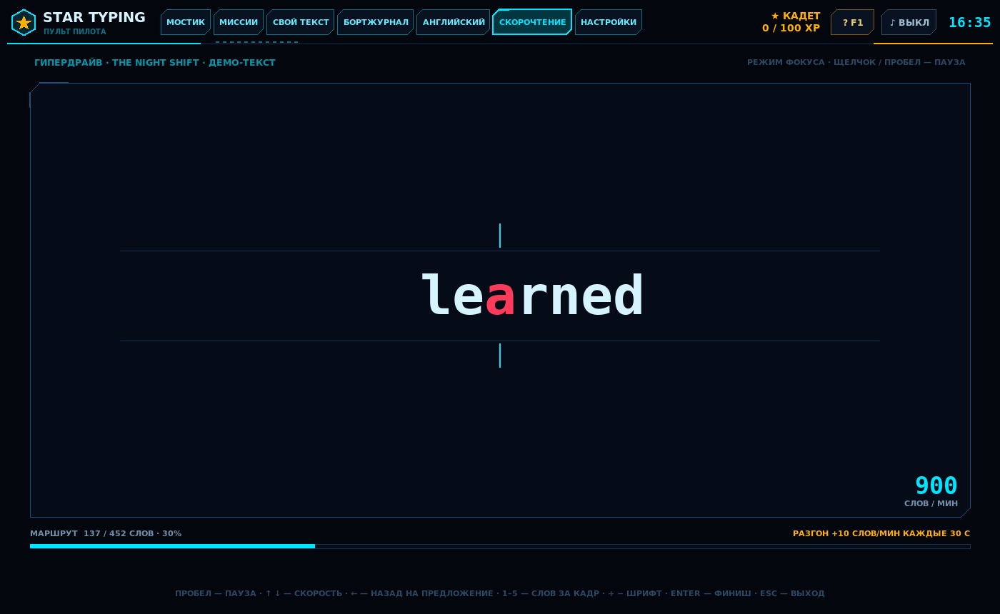
**ГИПЕРДРАЙВ** — RSVP: слово в прицеле, **красная буква** (ORP), разгон до целевой скорости,
клавиши 1–5 — слов в кадре. **Пробел** — пауза с контекстом (щелчок по слову продолжит с него);
**S** — к месту печати; **Enter** — финиш и тест. Настройки: старт/цель, разгон, паузы на знаках,
частота проверки понимания.

### Книга: обычная читалка с полки
Отдельный режим рядом с гипердрайвом (снимок разворота — [выше](#читалка--радиорубка--отдых)).
Текст нормализуется (склейка жёстких переносов Gutenberg), режимы **1 СТР / РАЗВОРОТ / 2 ЯЗЫКА / ПРОКРУТКА**,
темы **БУМАГА / НОЧЬ / СЕПИЯ**, оглавление, % и страницы внизу. Вход: **БИБЛИОТЕКА → 📖 КНИГА**.

| 2 языка (оригинал \| перевод) | Gutenberg · CEFR |
| --- | --- |
| 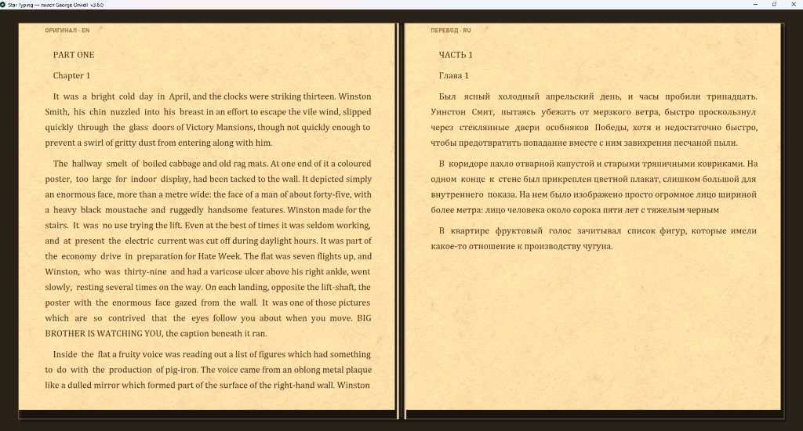 | 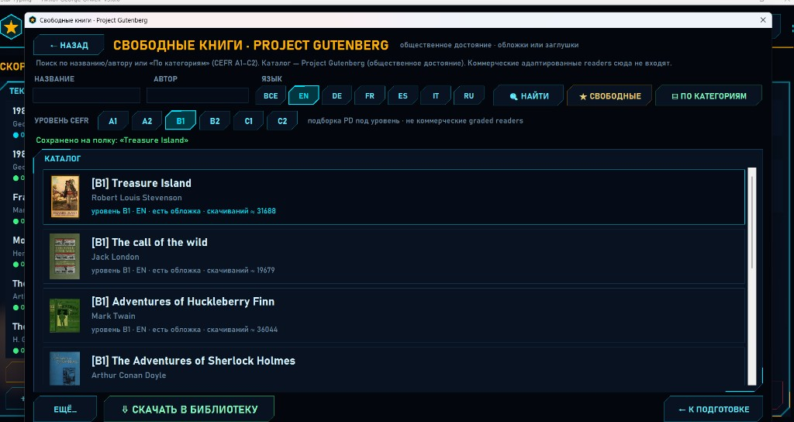 |
| Слева оригинал, справа перевод по предложениям (UPLINK). | **▤ ПО КАТЕГОРИЯМ** — уровни A1…C2. |

#### Свободные книги по уровню сложности (CEFR)
В каталоге Gutenberg (полка / библиотека → **★ СВОБОДНЫЕ**):

1. **🔍 НАЙТИ** — по названию и/или автору, фильтр языка (EN, DE, FR…).
2. **★ СВОБОДНЫЕ** — популярная лента public domain.
3. **▤ ПО КАТЕГОРИЯМ** — полоска **A1 · A2 · B1 · B2 · C1 · C2**: подборка книг общественного
   достояния, ориентированная на уровень (сказки и короткие тексты на A1–A2, приключения на B1,
   классика на B2–C1, плотные тексты на C2). Это **не** коммерческие graded readers (Oxford и т.п.) —
   только то, что можно легально скачать с Project Gutenberg. В списке метка `[B1]` и т.д.;
   **⇩ СКАЧАТЬ В БИБЛИОТЕКУ** — на полку пилота.


#### 2 ЯЗЫКА и перевод в гипердрайве
У обычных книг режим **2 ЯЗЫКА** собирает перевод страницы по предложениям (кэш UPLINK).
Книги **2ЯЗ** (готовый PD/MT-перевод в `translation.txt`) рисуют правую колонку из файла —
без UPLINK; печать и правка закрыты. В **ГИПЕРДРАЙВЕ** для обычных текстов —
**«ПЕРЕВОД ПОД СЛОВОМ»**; для **2ЯЗ** — переключатель **языка потока** (оригинал / перевод).

| Полёт с переводом | Пауза: оригинал + перевод |
| --- | --- |
| 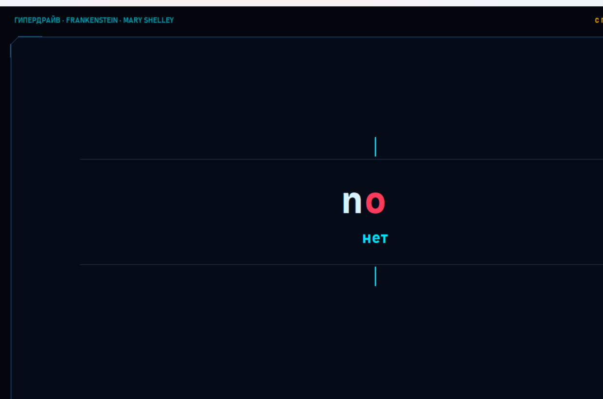 | 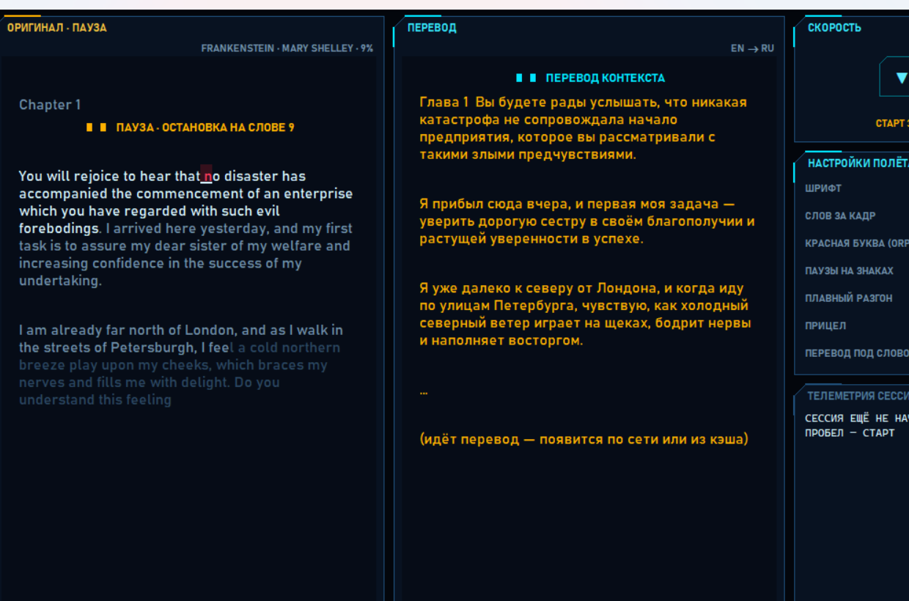 |

Эталоны — [docs/reader/](docs/reader/).

### Понимание, тренажёры, библиотека
После «ФИНИШ + ТЕСТ» или каждые N слов — вопросы «было ли слово…» / «закончите фразу»;
**эффективная скорость** = скорость × понимание.
Прочитанные предложения (с переводом) можно практиковать в **АНГЛИЙСКИЙ → ИЗ КНИГИ**.

| Тренажёр | Суть |
| --- | --- |
| **Шульте** | 3×3…7×7, числа или буквы; периферийное зрение, ошибка +2 с |
| **Горбов** | Чёрные ↑ и красные ↓ поочерёдно — переключение внимания |
| **Пирамида** | Ширина поля зрения в знаках без движения глаз |
| **Вспышка** | Тахистоскоп: слово мелькает → ввести; слова из вашего текста |

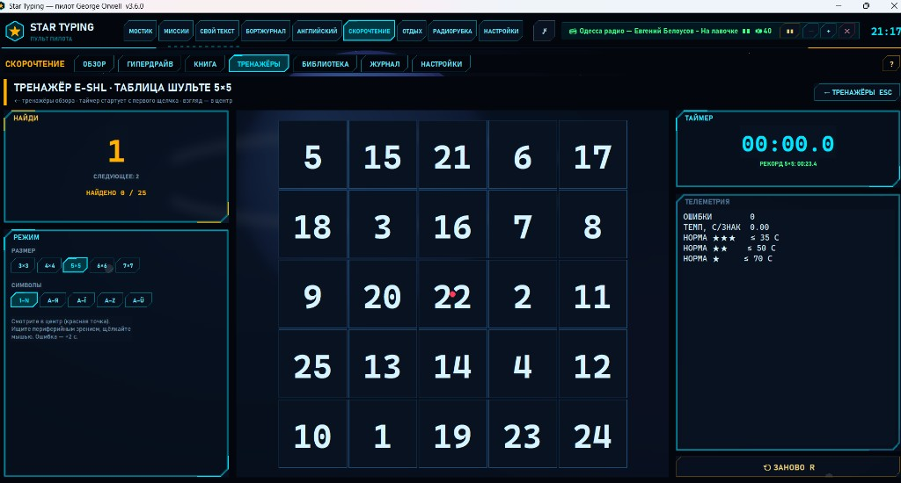

**Библиотека** — **＋ 2 ЯЗЫКА**: тот же каталог Gutenberg, что «Свободные книги» (поиск / лента / CEFR),
но только пары с PD-переводом; **⇩ СКАЧАТЬ 2ЯЗ** или **＋ ВРУЧНУЮ**. На полке — **2ЯЗ**.
Обычные тексты: **оригинал** (чтение) и **версия для печати**;
позиции связаны («читать с места печати» / «печатать»). PDF и `.txt` открываются сюда же;
удалённое уходит в `backups\deleted-texts`. Журнал — все сессии и XP. План:
[docs/speedread/](docs/speedread/).

## Радиорубка (онлайн-радио)

Снимок приёмника — [выше](#читалка--радиорубка--отдых). Станции из
[radio-browser.info](https://www.radio-browser.info): поиск, страна, язык, жанр, топ;
**★ МОИ ВОЛНЫ** на пилота; **ПРИЁМНИК** — ICY-трек, «В ЭФИРЕ», громкость, история сеанса;
**мини-приёмник** в шапке при фоне. Приглушение при озвучке и микрофоне; опция «приглушать
во время набора».

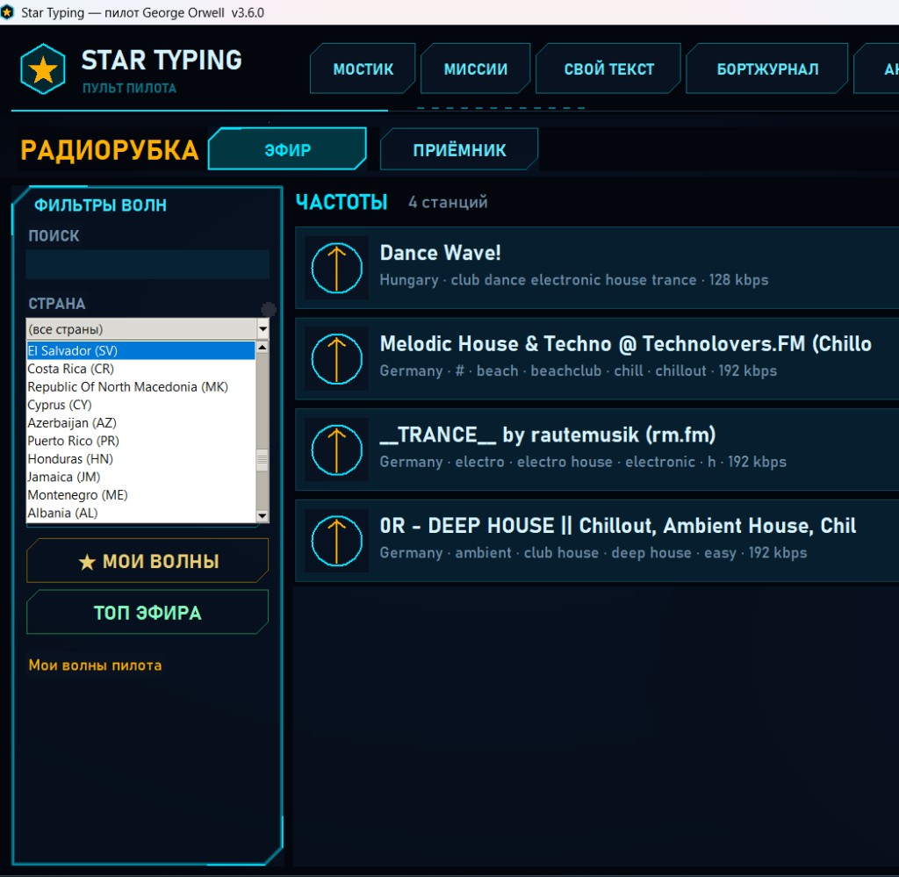

Звук — внешний **mpv** (или ffplay), без pip. Windows: `winget install -e --id shinchiro.mpv`
(поиск в PATH и в `C:\Program Files\MPV Player\`; либо `MPV_PATH` / `STAMINA_MPV`).
В шапке должно быть **приёмник: MPV**. F1 — [ИНСТРУКЦИЯ.md](ИНСТРУКЦИЯ.md) §15 · [docs/radio/](docs/radio/).

## Комната отдыха (ОТДЫХ)

Лобби — [выше](#читалка--радиорубка--отдых). Три игры в стиле HUD; рекорды в `lounge.json`;
при смене вкладки — пауза. F1 — [ИНСТРУКЦИЯ.md](ИНСТРУКЦИЯ.md) §14.

| Игра | Управление |
| --- | --- |
| **Тетрис** (стыковка блоков) | ← → двигать, ↑ поворот, ↓ ускорить, Пробел — сброс |
| **Змейка** (навигационный шнур) | стрелки или WASD; не врезаться в стены и в себя |
| **Арканоид** (отражатель щита) | ← → / A D, Пробел — пуск; 3 жизни |

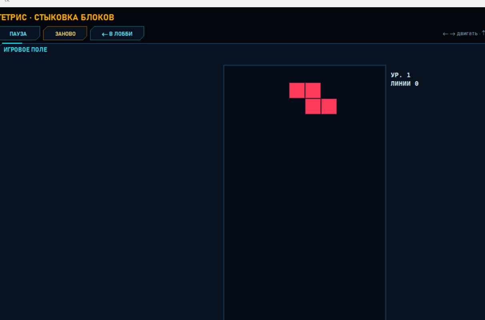
Во всех: **Esc** / **P** — пауза, **R** — заново, **← В ЛОББИ**.

## Экипаж и ДОСКА ПОЧЁТА (версия 3.4)

За одним ноутбуком занимаются несколько человек — у каждого **свой пилот**: позывной, эмблема,
акцентный цвет, звание и весь прогресс (печать и миссии, свой текст, английский, скорочтение,
библиотека). Данные пилота лежат в своей папке `%APPDATA%\Stamina\pilots\<id>\`, пилоты не видят
и не портят прогресс друг друга. Демо-экипаж на снимках вымышленный.

Вход и доска — [выше](#пульт-основные-экраны). На входе: ← →, Enter, Insert — новый пилот,
F2 — личное дело, Del — списать, «★ ДОСКА ПОЧЁТА». В шапке кабины — плашка пилота
(Ctrl+Shift+P — сменить). Доска: звание, XP, печать, английский, чтение, Шульте; период
«всё время» / «неделя»; сортировка по колонкам; код для просмотра не нужен.

| Новый пилот | Код доступа |
| --- | --- |
| 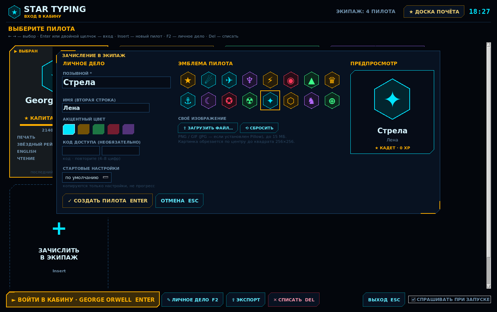 | 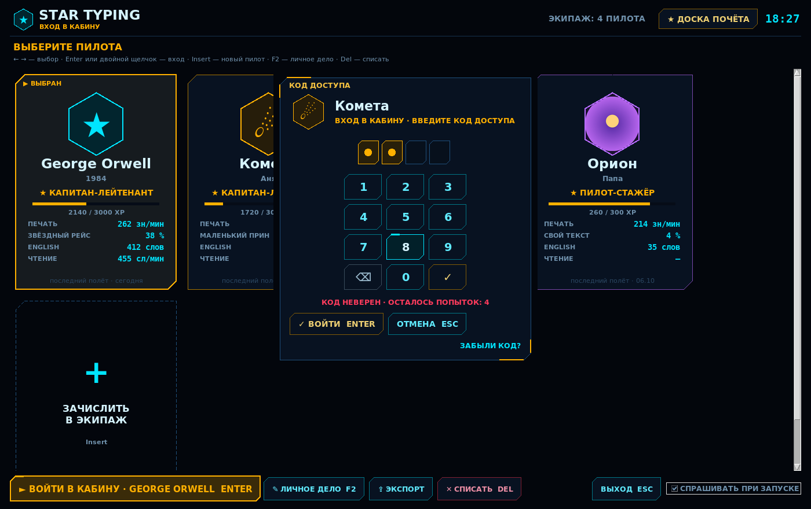 |
| Позывной, эмблема, цвет, копирование настроек. | 4–8 цифр, блокировка после 5 ошибок; сброс с подтверждением. |

**Как устроено:**
- **Перенос без потерь.** При первом запуске 3.4 прежние данные копируются в пилота №1
  «George Orwell / 1984» с проверкой SHA-256; перед этим — резервная копия
  `backups\pre-pilots-<дата>\`, старые файлы в корне переименовываются в `*.migrated`.
- **Код доступа** — необязательный, 4–8 цифр; хранится только солёный хэш PBKDF2-SHA256
  (200 000 итераций). Это защита от случайного входа в чужой профиль, а не шифрование.
  Кодов по умолчанию нет нигде — ни в программе, ни в тестах, ни в документации.
- **Смена пилота** — всё сохраняется, программа перезапускается с экраном входа. Ярлык на конкретного
  пилота: `main.py --pilot "<позывной>"` (или переменная `STAMINA_PILOT`).
- **Экспорт / импорт** — файл `.stpilot` (zip + манифест с SHA-256); при импорте новый id и свободный позывной.

Устройство и план: [docs/pilots/](docs/pilots/) (SPEC_PILOTS, CURSOR_TASK_PILOTS, макеты).

## Живой космос (версия 3.5)

Во **всех разделах** за полупрозрачными «голографическими» панелями — живой космос: звёзды в трёх
слоях с параллаксом, кометы с хвостами, далёкие планеты (одна с кольцом), астероиды. В открытых
местах (иллюминатор мостика, просветы между панелями, поле карточек на входе в кабину) сцена резкая;
под панелями и кнопками — **матовое стекло**: размыто, затемнено и подкрашено в цвет панели, поэтому
текст, цифры и кнопки остаются чёткими. Когда вы печатаете, корабль «разгоняется», а резкое окно
обновляется реже, чтобы не мешать.

**Настройки → «Живой космос»:** `ВЫКЛ` · `ЛЁГКИЙ` (по умолчанию, до 12 к/с) · `ПОЛНЫЙ` (до 24 к/с,
больше объектов). Если «полный» на вашем компьютере не успевает (кадр > 30 мс 5 секунд подряд),
программа сама переходит на «лёгкий» до перезапуска. При выключенной анимации Windows
(«уменьшение движения») картинка неподвижна. Нужен **Pillow** (`pip install -r requirements.txt`);
без него фон просто выключен.

Анимация — GIF в начале README (там же ссылка на MP4). Фон один во всех вкладках;
отдельные снимки каждого отсека с космосом не дублируем.

| Мостик, ожидание | Мостик, набор |
|---|---|
| 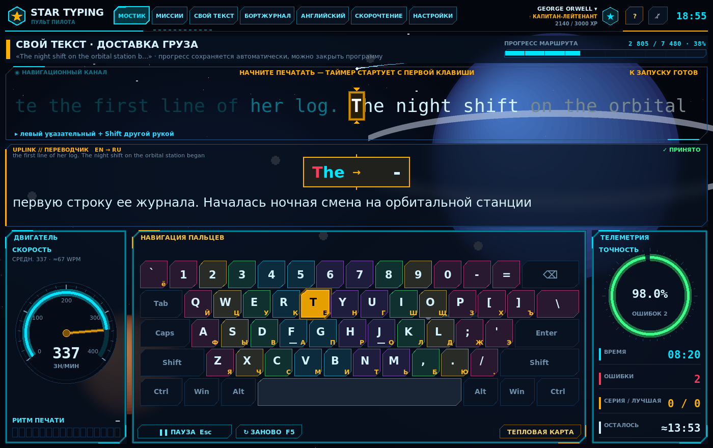 | 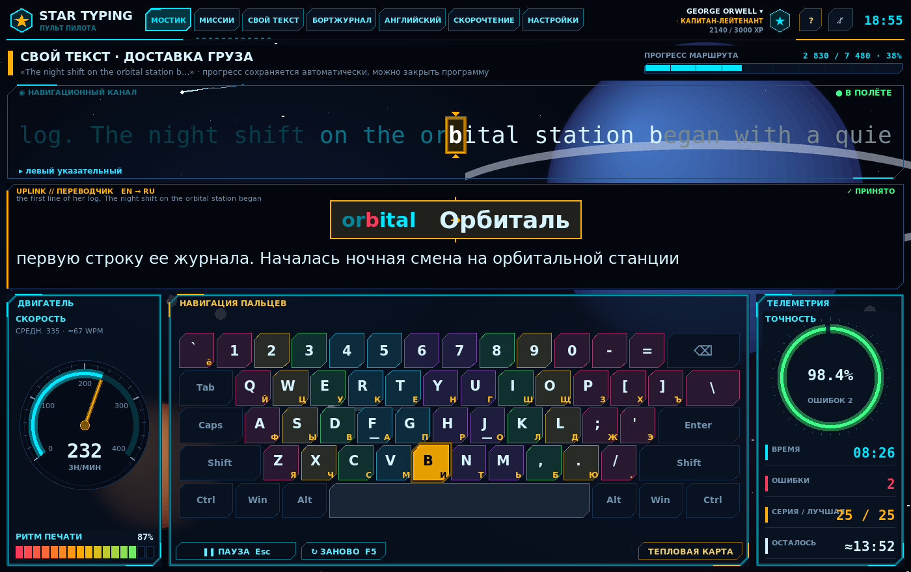 |

Замер на ноутбуке (HP, Ryzen 3, 8 ГБ, окно 1260×800, % одного ядра — весь процесс Star Typing):

| Режим | Простой: к/с · CPU | Печать ~300 зн/мин: к/с · CPU |
|---|---|---|
| ВЫКЛ | — · 8 % | — · 17 % |
| ЛЁГКИЙ | 11 · 11 % | 6 · 22 % |
| ПОЛНЫЙ | 21 · 39 % | 11 · 38 % |

Как это укладывается в слабый ноутбук без numpy: статичный слой (туманности и планеты) кэшируется;
каждый кадр рисуются только звёзды, кометы и астероиды и только в резких окнах; стекло считается в
половинном разрешении и размывается раз в 6 секунд, а между пересчётами перерисовываются только те
панели, над которыми пролетает комета или астероид; изображения вставляются в уже созданные
PhotoImage (`paste`). Подробно — [docs/living_space/SPEC.md](docs/living_space/SPEC.md).

## Язык интерфейса, PDF и книги на разных языках (версия 3.6)

### Язык интерфейса: русский, українська, English, Deutsch
Выбор — на экране приветствия (меняется **сразу**) и в **НАСТРОЙКИ → Язык интерфейса** (применяется
**после перезапуска**; кнопка «⟳ ПЕРЕЗАПУСТИТЬ» перезапускает программу с тем же пилотом, прогресс сохраняется).
Переводятся только надписи программы: тексты для печати, словари английского и книги остаются как есть.
Инструкция F1 пока только на русском. Выбор общий для всех пилотов (файл `ui.json` в папке данных).

Интерфейс на английском / немецком выглядит так же, как русский HUD — меняются только подписи
(`screenshots/i18n_en_bridge.png`, `screenshots/i18n_de_settings.png` в репозитории).

### Открыть PDF
**СВОЙ ТЕКСТ → «ОТКРЫТЬ PDF…»** или **СКОРОЧТЕНИЕ → БИБЛИОТЕКА → «＋ ОТКРЫТЬ PDF»** (и просто `.pdf` в «Открыть файл»).
Текст достаётся библиотекой `pypdf` (ставится «УСТАНОВИТЬ ВСЁ» / `install.bat` / `install.sh`) и чистится: склеиваются
переносы «сло-/во», строки собираются в абзацы, убираются номера страниц и повторяющиеся колонтитулы, исправляются
лигатуры (fi → fi). Можно выбрать диапазон страниц и посмотреть текст до импорта. Дальше это обычная книга
библиотеки: оригинал + версия для печати, скорочтение, UPLINK. Книга на 270 страниц читается за ~5 секунд.
Сканы без текстового слоя распознаются и честно показывают сообщение: сначала прогоните файл через OCR
(OCRmyPDF, Tesseract, ABBYY, «Сохранить как текст» в Adobe Reader). Встроенный OCR — в планах.

### Книги на русском, украинском, немецком, английском…
* Язык книги определяется сам, без интернета (ru, uk, be, en, de, fr, es, it, pt, pl, cs, nl, sv).
* Печать кириллицы с украинскими **і ї є ґ** и апострофом (м'ясо, сім'я — апостроф внутри слова остаётся),
  немецкие **ä ö ü ß**. Подсказка раскладки на экранной клавиатуре: **ЙЦУКЕН RU / ЙЦУКЕН UA / QWERTZ / QWERTY**.
  Если нажата буква не той раскладки — подсказка «переключите раскладку».
* Опции подготовки текста: **«Без умлаутов: ä ö ü ß → ae oe ue ss»** (если нет немецкой раскладки) и **«Ё → Е»**.
* Статистика и тепловая карта считают каждую букву; в БОРТЖУРНАЛЕ карта переключается **EN / DE / RU / UA**.
* **UPLINK переводит в любую сторону** между ru / uk / en / de (и с других языков): НАСТРОЙКИ → «UPLINK: перевод на»
  (АВТО = язык интерфейса). Книга на языке перевода переводится на английский (русская/украинская) или на русский.
  Направление видно в заголовке панели: «UPLINK // ПЕРЕВОДЧИК  DE → RU». Перевод онлайн (Google, запасной MyMemory);
  без сети — только фразы, уже лежащие в кэше (кэш отдельный для каждой пары языков).
* Скорочтение: ORP-буква для кириллицы и умлаутов, главы «Розділ / Kapitel / Teil», тест на понимание на языке
  текста, Шульте с буквами А–Я / А–Ї / A–Z / A–Ü, вспышки слов и пирамида на языке книги.

### Как добавить язык интерфейса
1. Скопируйте `stamina/i18n/en.json` в `stamina/i18n/xx.json` (`xx` — код языка) и переведите **значения**
   (ключи — русские фразы — не трогайте; `{0}`, `{1:.0f}` и т. п. сохраните как есть).
2. Добавьте язык в `LANGS` в `stamina/i18n/__init__.py`: `"xx": "Название"`.
3. Проверьте: `python tools/i18n_check.py` (или `python tools/i18n_check.py --missing xx` — список непереведённых фраз).
   Непереведённые фразы показываются по-русски, программа не ломается.
4. После правок кода, где появились новые надписи `t("…")`: `python tools/i18n_check.py --fix-ru`.
Как получены машинные переводы uk/en/de — `tools/i18n_mt/README.md`.

## Горячие клавиши
| Клавиша | Действие |
| --- | --- |
| F1 | справка (инструкция) |
| Esc / Del | пауза / продолжить |
| F5 | начать заново |
| F9 | звук вкл/выкл |
| Home / PgUp / PgDn | Орион / слайдшоу в простое / полный экран (выход — Esc/Del) |
| Ctrl+1…8 | разделы: Мостик, Английский, Скорочтение, Отдых, Радиорубка, Эфир, Орион, Настройки |
| Ctrl+Shift+P | сменить пилота (экран «ВХОД В КАБИНУ») |
| Скорочтение: Пробел / ↑ ↓ / ← → / 1–5 / S / Enter | пауза / скорость / по предложениям / слов в кадре / к месту печати / финиш и тест |
| В отчёте: Enter / → / R / Esc | повторить / следующая миссия / ремонт / закрыть |
| **Tab** | без мыши: прыжок в главное меню; ещё раз Tab — к кнопкам раздела |
| **← → ↑ ↓** (кнопка в фокусе) | соседняя вкладка / подвкладка / кнопка |
| **Enter / Пробел** (кнопка в фокусе) | нажать; **Esc** или **Shift+Tab** — убрать фокус |

Кнопка в фокусе отмечена янтарными уголками. Во время полёта на мостике Tab и стрелки идут в печать:
выйти к меню — **Esc**, затем **Tab**. Работает во всех разделах, на экранах приветствия и входа, в диалогах.

## Где хранятся данные
`%APPDATA%\Stamina\` (на Linux `~/.local/share/StarTyping`, старая `~/.stamina` — если уже есть). С версии 3.4 там лежат реестр экипажа `pilots.json`,
общий `app.json` (размер окна) и папки пилотов `pilots\<id>\`; в папке **каждого пилота** — файлы
из таблицы ниже (формат прежний), плюс `profile.json` и `avatar.png`.

| Файл | Что внутри |
| --- | --- |
| `session.json` | незаконченный свой текст и место, где вы остановились (формат как в версии 2) |
| `stats.json` | история заходов, ошибки по клавишам, звёзды миссий, опыт |
| `settings.json` | настройки и размер окна |
| `cargo.txt`, `cargo_original.txt` | свой текст: адаптированный и оригинал |
|   `english.json` | прогресс вкладки «АНГЛИЙСКИЙ»: карточки, свои переводы, отсеки, XP |
| `library\` | общая библиотека текстов: оригинал, версия для печати и позиции каждого текста |
| `speedread.json` | скорочтение: сессии чтения, рекорды тренажёров, настройки |
| `lounge.json` | рекорды комнаты отдыха |
| `radio.json`, `radio_cache.json` | избранные станции и кэш топа эфира |

Личные данные в репозиторий не попадают: они лежат вне папки программы, а `.gitignore`
дополнительно исключает `session.json`, `stats.json`, `settings.json`, `english.json`,
`speedread.json`, `library/`, `pilots.json`, `app.json`, `pilots/`, `*.stpilot`, логи,
`cache/` и `models/`.

Кэш переводов: `cache\translations.json` в папке программы.

## Установка и запуск
Для новичка — [Быстрый старт](#-быстрый-старт-для-новичка) (`install.bat` / `bash install.sh`). Вручную:
```bash
git clone https://github.com/Teslyar75/My_Stamina.git
cd My_Stamina
python -m venv .venv          # Linux: python3 -m venv .venv
.venv\Scripts\pip install -r requirements.txt    # Linux: .venv/bin/pip install -r requirements.txt
python main.py
```
Проверка произношения (необязательно; модель Vosk ~40 МБ в git не хранится):
`pip install vosk sounddevice` и `python scripts/download_vosk_model.py`.
- `install.bat` / `install.sh` — установка в один шаг; `Stamina.bat` / `run.sh` — запуск;
- `create_shortcut.ps1` — ярлык «Star Typing» на рабочем столе Windows (из `.venv`, если есть);
- данные: Windows `%APPDATA%\Stamina`, Linux `~/.local/share/StarTyping` (прежняя `~/.stamina` тоже читается).

## Тесты
```powershell
python -m unittest discover -s tests -v
```

## Структура проекта
```
main.py                 точка входа (её запускает ярлык)
Stamina.bat             запуск двойным кликом без консоли
create_shortcut.ps1     создание ярлыка на рабочем столе
ИНСТРУКЦИЯ.md           инструкция пилота (открывается в программе по F1)
CHANGELOG.md            история изменений
CURSOR_TASK.md          описание задачи и статус для Cursor
VIBE_CODING.md          набор промптов для вайбкодинга проекта
screenshots/            скриншоты для README (reader/, radio/, lounge/)
stamina/                пакет программы (имя прежнее, чтобы не ломать запуск)
  app.py                запуск, чёткий текст на экранах 125–150 %, своя иконка на панели задач
  assets/               иконка Star Typing (star_typing.ico, star_typing_64.png)
  cockpit.py            главное окно: верхняя панель, разделы, горячие клавиши
  bridge.py             «Мостик»: тренировка, приборы, отчёт, переводчик
  screens.py            «Миссии», «Свой текст», «Бортжурнал», «Настройки», «Справка»
  hud.py                виджеты HUD: кнопки, панели, спидометр, кольцо, иллюминатор, клавиатура, график
  engine.py             логика набора: скорость, точность, ритм, честное время
  missions.py           миссии, генерация упражнений, ремонт слабых клавиш, звания
  layouts.py            клавиатура EN/RU и зоны пальцев
  sounds.py, sounds/    синтез и проигрывание звуков
  translator.py         UPLINK: разбиение на предложения, перевод в фоне, кэш
  storage.py            настройки, статистика, свой текст
  session_storage.py    сохранение незаконченного текста (session.json)
  text_processing.py    адаптация текста
  theme.py              цвета, шрифты, масштаб
  english_hook.py       подключение вкладки «АНГЛИЙСКИЙ»
  english/              вкладка «АНГЛИЙСКИЙ»: экраны, словарь, прогресс, озвучка, распознавание речи
    data/vocab.json     словарь 20 000 слов (открытые источники, CC BY-SA 4.0)
    data/vocab_dev.json IT Interview (~580 терминов, CodersLingo CC BY 4.0)
docs/                   ENGLISH_TAB.md, ENGLISH_DESIGN.md, ENGLISH_DATA.md
scripts/                download_vosk_model.py / .ps1; build_dev_vocab.py — IT-словарь
tools/vocab_builder/    скрипты сборки словаря из открытых источников (для приложения не нужны)
models/                 (не в git) модель Vosk
tests/                  тесты адаптации, логики набора, миссий и переводчика
```

## Промо-материалы

- 📘 [Брошюра (PDF, 27 стр.)](docs/promo/StarTyping_brochure.pdf)
- 📄 [Краткое промо (PDF, 8 стр.)](docs/promo/StarTyping_promo_short.pdf)

## Вдохновение

- **Слепая печать.** На создание тренажёра вдохновили программы вроде «Стамины» (Stamina) —
  название упомянуто здесь только с благодарностью, код и материалы у нас свои.
- **Английский по карточкам** — давно известная практика, но конкретно здесь вдохновил
  Богдан Стащук — подробнее в разделе [«Благодарности / Идея»](#благодарности--идея).
- **Скорочтение.** Интерфейс этой части фактически стал шаблоном для множества похожих программ;
  кого благодарить за саму идею, автор пока не знает — если подскажете, с радостью добавим.

## Благодарности / Идея

Идею модуля английского подсказал **Богдан Стащук (Bogdan Stashchuk)** — автор
[YouTube-канала](https://www.youtube.com/@Bogdan_Stashchuk) и
[курсов по программированию на Udemy](https://www.udemy.com/user/bogdanstashchuk/), а также
проекта [bsmarted.com](https://bsmarted.com/). Спасибо за вдохновение!

Реализация, дизайн, код и данные здесь — наши собственные: словарь собран из открытых
источников (ниже), никакие материалы bsmarted.com не используются. Программ такого рода много;
эта — личный вариант, встроенный в тренажёр печати Star Typing.

## Источники данных и лицензии

| Что | Источник | Лицензия |
| --- | --- | --- |
| Частотный список слов, ранги | [wordfreq](https://github.com/rspeer/wordfreq) | данные CC BY-SA 4.0, код Apache 2.0 |
| Переводы на русский, части речи, IPA, переносы | [Wiktionary](https://www.wiktionary.org/) (дамп [kaikki.org](https://kaikki.org/)) | CC BY-SA 4.0 |
| Определения, части речи, темы | [WordNet 3.0](https://wordnet.princeton.edu/) | WordNet License (Princeton) |
| Произношение | [CMUdict](https://github.com/cmusphinx/cmudict) | BSD-2-Clause |
| Примеры предложений EN–RU | [Tatoeba](https://tatoeba.org/) | CC BY 2.0 FR |
| Частоты русских слов (выбор перевода) | [FrequencyWords](https://github.com/hermitdave/FrequencyWords) | CC BY-SA 4.0 |
| Машинный перевод части слов и сгенерированных примеров | [Helsinki-NLP opus-mt-en-ru](https://huggingface.co/Helsinki-NLP/opus-mt-en-ru) | Apache 2.0 |
| Генерация простых примеров (где нет Tatoeba) | [Qwen2.5-1.5B-Instruct](https://huggingface.co/Qwen/Qwen2.5-1.5B-Instruct) | Apache 2.0 |
| IT-термины для набора S-DEV (`vocab_dev.json`) | [CodersLingo](https://coderslingo.com/glossary/) | CC BY 4.0 |
| Распознавание речи (скачивается отдельно) | [Vosk](https://alphacephei.com/vosk/models) `vosk-model-small-en-us-0.15` | Apache 2.0 |

Файл словаря `stamina/english/data/vocab.json` распространяется на условиях **CC BY-SA 4.0**
(из-за данных Викисловаря и wordfreq). Предложения Tatoeba — CC BY 2.0 FR, номер предложения
хранится в поле `tatoeba_id` (страница `https://tatoeba.org/sentences/show/<id>`).
`vocab_dev.json` — адаптация CodersLingo (**CC BY 4.0**).

## История изменений
Что нового в версии 3.0 «Пульт пилота», что удалено и почему, смотрите в [CHANGELOG.md](CHANGELOG.md).
