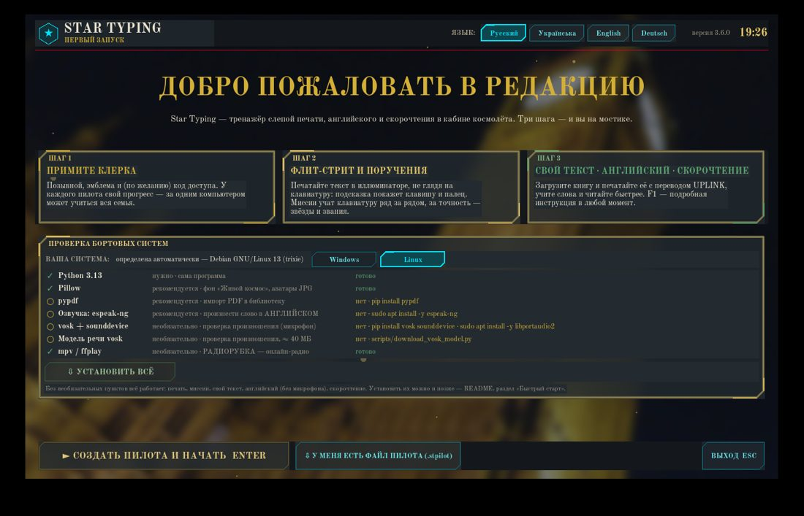
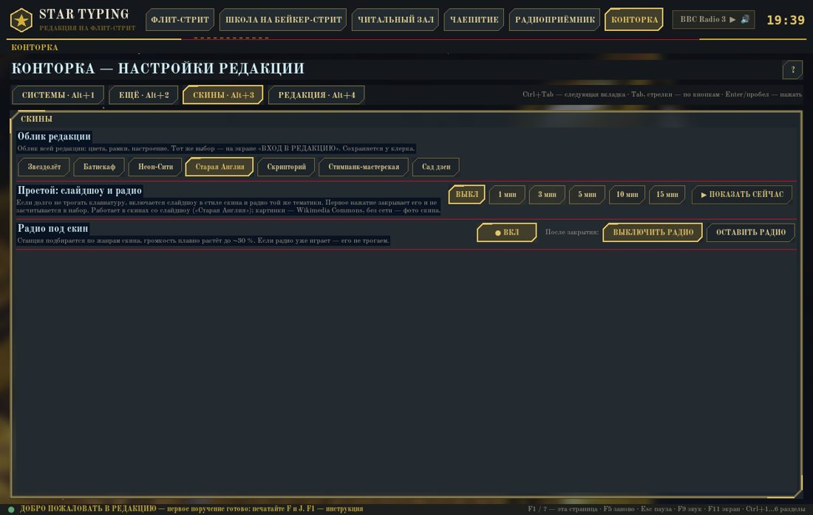
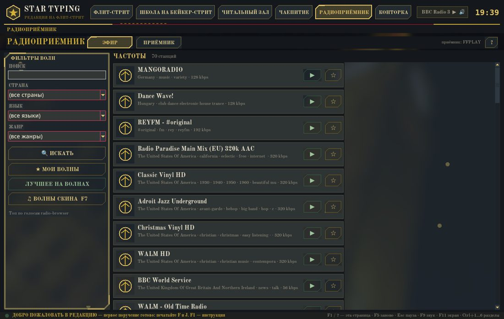
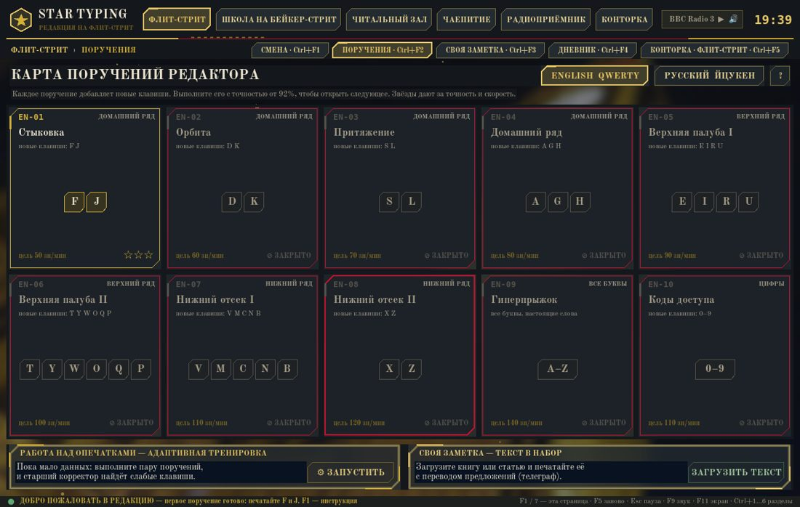

# Новые возможности — октябрь 2026 (десктоп)

Все скриншоты: [docs/showcase_new/](showcase_new/)

## История пилота
Пилот прочитал книгу и окружил себя её миром — так появляются скины. Звездолёт остаётся основным скином по умолчанию.

### Скин «Старая Англия» (D1)
Пилот прочитал книгу и окружил себя её миром. **Звездолёт** остаётся основным скином по умолчанию; переключение — Настройки → Скины.
- Полупрозрачный лондонский **туман**, «газетные» карточки, цвета скина в HUD.
- **Слайдшоу** в простое и **радио скина** (Настройки, клавиша **F7**, описано в справке F1).
- **357 строк** голосового пакета ru/uk/en/de: космическая лексика заменена английской во всех разделах (миссии → поручения и т. д.).

| Вход | Мостик в скине |
| --- | --- |
|  |  |
| **Настройки → Скины** | **Радио скина** |
|  |  |
| **Поручения (миссии)** | **Слайдшоу** |
|  |  |

### Звуки скинов
Звук ищется по цепочке: файл скина → папка звуков скина (с правилом для кликов) → звук по умолчанию.

### Комната отдыха
- Змейка: после поражения **Esc перезапускает** игру (подсказка «Esc пауза / заново · R заново») — в PR #19.

### В планах
- **Гид ОРИОН** на десктопе (Python/tkinter) — порт с веба: диалоги, события, шутки, приглушение радио. Пока **только в планах**; в вебе уже работает. Видение и чеклист порта: [ORION_VISION.md](ORION_VISION.md).
- Новые скины («Чёрная Америка»), немецкий как изучаемый язык (карточки, упражнения, примеры).

## Где что
- Скин — Настройки → Скины; радио скина — Настройки или F7; справка — F1.
- Орион (планы десктопа / сделано в вебе) — [ORION_VISION.md](ORION_VISION.md).
